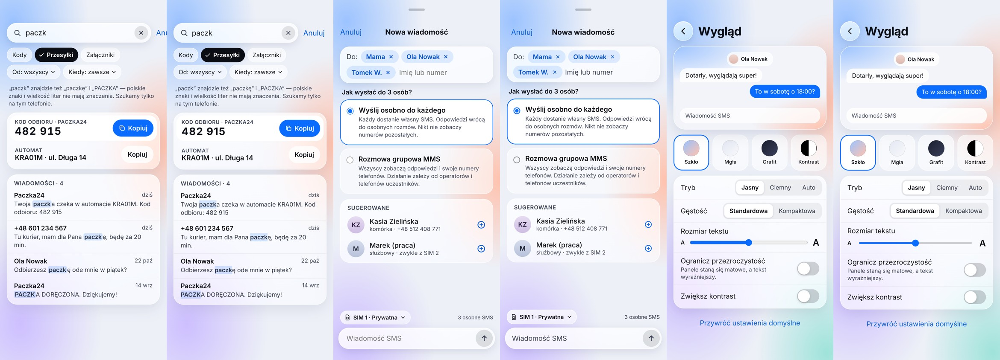

# CH016–CH018: sprawdzenie działającego demo w emulatorze

10.11.2026. Android Emulator arm64, Android 15 / API 35. Sprawdzenie przez
rzeczywiste stuknięcia, wpisywanie, wklejanie, przewijanie i odczyt drzewa
dostępności; zapis preferencji potwierdzony także w DataStore aplikacji demo.

**Wynik:** zakończono sprawdzenie S07–S09 i poprawiono cztery problemy.
Po poprawkach: 57 testów JVM bez błędów, poprawny build i lint demo.
[Rejestr 50 punktów sprawdzenia i pomiarów](CH016_CH018_Android/emulator_2026-11-10/weryfikacja.json)
zawiera przypadki UI, czynności przygotowania/odtworzenia środowiska i zrzuty.
Nie jest to liczba automatycznych testów instrumentation.

## Znalezione i poprawione problemy

1. **Dostępność i modalność arkuszy.** Pod Nową wiadomością czytnik widział dock
   i wiersze Skrzynki. Ukryto semantykę zasłoniętego ekranu, dodano nazwę panelu
   i blokadę przekazywania stuknięć przez tło. Sprawdzone: brak elementów Skrzynki
   w drzewie dostępności arkusza; stuknięcie w pozycję ukrytego docka nie zmienia zakładki.
2. **Klawiatura odbiorcy.** Pole „Imię lub numer” wywoływało klawiaturę telefoniczną,
   utrudniając szukanie po nazwie. Teraz udostępnia litery i numery. Potwierdzono
   wpisanie `kasia` pięcioma stuknięciami w klawiaturę ekranową i wybór kontaktu.
3. **Semantyka przełącznika.** Opis i stan występowały na osobnych elementach,
   przez co element z etykietą nie miał akcji i stanu `checked`. Teraz jeden węzeł
   ma nazwę, rolę Switch, akcję i stan. Potwierdzono `checked=true` oraz powrót do `false`.
4. **Większy tekst i mały ekran.** Etykieta „Gęstość” oraz nazwy opcji były łamane
   w środku słowa. Przy większej czcionce etykieta jest nad kontrolką; jeżeli zmierzone
   szerokości opcji nie mieszczą się w rzędzie, opcje układają się pionowo.
   Domyślny układ S09 zachowuje geometrię wzorca. Sprawdzone na 320×640 dp przy
   systemowym fontScale 1,3 i na zwykłym ekranie przy kroku tekstu 7.

## Sprawdzone zachowania

| Ekran | Próby w działającej aplikacji |
| --- | --- |
| S07 | Wejście ze Skrzynki; cztery wyniki `paczk`; Kody, Załączniki, Przesyłki, nadawca i ostatni tydzień; brak wyników; oba Kopiuj zweryfikowane przez wklejenie różnych wartości do pola; otwarcie konkretnej wiadomości Oli; powrót z zapytaniem i filtrami; rzeczywiste zachowanie scrolla po powrocie na małym ekranie; 300 znaków w polu i Wyczyść; Anuluj. |
| S08 | Pusty formularz blokuje Wyślij; ręczny numer rozpoznaje kontakt; wybór po nazwie; 1, 3 i 8 odbiorców; zawijanie chipów i usunięcie środkowego bez utraty sąsiadów; wybór SMS/MMS i liczba operacji; zmiana SIM; kompozytor nad IME; Back chowa klawiaturę i zachowuje edytor; anulowanie i ponowne wejście przywracają szkic; podwójne Wyślij daje pojedyncze wiadomości w trzech osobnych rozmowach demo; MMS otwiera wspólną rozmowę. |
| S08 — odtworzenie | Aplikację przeniesiono do tła, zabito jej proces bez force-stop i ponownie otwarto. PID zmienił się; wróciły otwarty arkusz, szkic, kontakt oraz SIM 2. |
| S09 | Przełączniki zmieniają preferencje i stan dostępności; kroki suwaka 1/4/7 zapisane w DataStore; reset; Grafit/Ciemny aktualizują podgląd i mają opis roboczego wariantu; powrót z Ustawień zachowuje wybór; preferencje przetrwały force-stop. Reset jest osiągalny przez przewijanie także na małym ekranie. |

Próby wysyłki dotyczyły wyłącznie transportu demonstracyjnego — bez SMS do sieci.
Testy modeli obejmują dodatkowo częściowy błąd kolejki i ponowienie bez duplikatów.

## Obraz po poprawkach

Zrzuty: ramka 390×844 dp, density 560 (DPR 3,5), fontScale 1,0. Przed zapisem
zamknięto systemowe objaśnienie trybu pełnoekranowego. Oryginalne goldeny CH002
pozostają niezmienione. W każdej parze na planszy golden jest po lewej:

| Ekran | Piksele z różnicą >16/255 względem goldenów CH002 |
| --- | ---: |
| S07 | 4,9680% |
| S08 | 6,3597% |
| S09 | 4,0273% |

S01–S06 także ponownie wyrenderowano i przejrzano na
[planszy kontrolnej](CH016_CH018_Android/emulator_2026-11-10/S01-S06.jpg).
Nie jest to porównanie z osobnym APK sprzed zmian. Różnice względem goldenów
wynoszą odpowiednio 3,4441%, 6,4698%, 7,0034%, 18,0231%, 4,5000%, 4,9202%.
S04/S05 nadal mają prawdziwą rozmowę pod arkuszem, zgodnie z wcześniejszym opisem.

Emulator używa API 35, a wzorce pochodzą z S26 / API 37. Wyników nie należy
traktować jako pomiaru na tym samym rendererze ani dowodu pełnej zgodności 1:1.
Pozostają znane różnice, m.in. całkowicie widoczne Anuluj w S07, obramowania,
wyróżnienia i kontrolka suwaka.

## Granice odbioru

- Potwierdzono semantykę dostępności; pełny odsłuch i ręczny przegląd TalkBack
  nie zostały wykonane.
- Nadal otwarty jest końcowy odbiór na fizycznym urządzeniu i G03, w tym API 31
  oraz wydajność szkła. Emulator nie zamyka tych bramek.
- Wariant `full`, prawdziwe transporty oraz pełne tokeny pozostałych motywów
  pozostają poza zakresem CH016–CH018.
- Po sprawdzeniu przywrócono rozdzielczość, density i systemowy fontScale
  emulatora, domyślne preferencje demo oraz otwarto Skrzynkę z czystym fixture.
